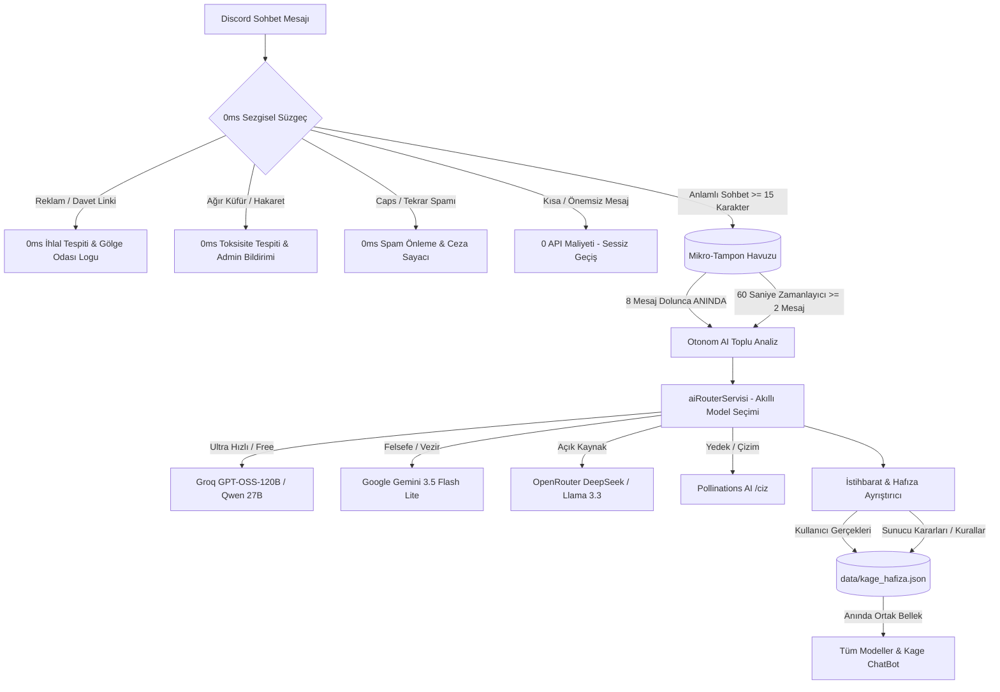

# <p align="center">⛩️ K A G E ⛩️</p>
<p align="center">
  <strong>Manga Okuma Platformu, Bağımsız Indie Oyun ve Hepsi Bir Arada Yeni Nesil Discord Sunucu Yönetim Sistemi</strong><br>
  <em>"Sessizce oku, derinlere in. Kaleyi adalet, çelik ve gölgelerle kur."</em>
</p>

<p align="center">
  <a href="https://nodejs.org"></a>
  <a href="https://discord.js.org"></a>
  <a href="https://aistudio.google.com"></a>
  <a href="https://kage95.com"></a>
  <a href="#"></a>
  <a href="#"></a>
  <a href="#"></a>
  <a href="LICENSE"></a>
</p>

---

```text
  ██╗  ██╗ █████╗  ██████╗ ███████╗
  ██║ ██╔╝██╔══██╗██╔════╝ ██╔════╝
  █████╔╝ ███████║██║  ███╗█████╗  
  ██╔═██╗ ██╔══██║██║   ██║██╔══╝  
  ██║  ██╗██║  ██║╚██████╔╝███████╗
  ╚═╝  ╚═╝╚═╝  ╚═╝ ╚═════╝ ╚══════╝
       ⛩️  K  A  G  E  •  B O T  ⛩️
```

**Kage**, **[kage95.com](https://kage95.com)** canlı modern manga okuma platformu ve ana teknoloji şirketi **JagTech** çatısı altında kurucusu **Jagwey** tarafından geliştirilen bağımsız indie oyunu için sıfırdan tasarlanmış; **MEE6, Carl-bot veya harici botlara ihtiyaç bırakmayan**, bünyesinde **Google Gemini Flash yapay zekasını, Groq Cloud & OpenRouter hibrit ağını, kendi kendine öğrenen hafıza motorunu, tam teşekküllü RPG ekonomi ve dövüş mekaniklerini, interaktif kayıt panelini ve 28 parçalık ikiz piksel sticker setini** barındıran hepsi bir arada Discord botudur.

---

## 🩸 Öne Çıkan Yetenekler

### 1. 🏗️ Tek Tıkla Samuray Kalesi Kurulumu (`/sunucu-kur`)
Sunucunuz tamamen boş veya dağınık olsa dahi, tek bir komutla tüm sunucuyu profesyonel bir samuray tapınağına çevirir:
- **Hiyerarşik Samuray Rolleri**: `👑 Kage (Yönetici)`, `🥷 Anbu (Moderatör)`, `🗡️ Jonin (Kıdemli Savaşçı)`, `🏮 Chunin (Sadık Okur)`, `📜 Gölge Genin (Yeni Üye)`.
- **Hazır Kategori & İzin Mimarisi**:
  - `⛩️ BİLGİLENDİRME` (Kurallar, Duyurular, Yeni Bölümler, Hoş Geldiniz)
  - `💬 TOPLULUK & SOHBET` (Genel Sohbet, Manga Tartışma, Spoiler Odası, Medya, Bot Komut)
  - `🎮 KAGE INDIE OYUN` (Oyun Duyuru, Geliştirici Günlüğü, Hata Bildirim)
  - `🔊 SES MECLİSİ` (Gölge Tapınağı, Samuray Meclisi, Sessiz Okuma)
  - `🛡️ YÖNETİM & GÖLGE ODASI` (Sadece Kage ve Anbu'ya özel gizli yönetim odası, AI vezir kanalı ve mod-log)
- Kanallar açıldığı anda log kayıtları, karşılama mesajları ve yapay zeka kanalları otomatik olarak sisteme kilitlenir.

---

### 2. 🧠 Akıllı Çoklu Yapay Zeka Ağı (Multi-AI Mesh) & Model Kontrolü
- **Çoklu Model Yönlendiricisi (`aiRouterServisi.js`)**: Tek bir sağlayıcıya bağımlı kalmaz. Göreve göre en uygun yapay zekayı dinamik seçer:
  - **Google Gemini 3.5 Flash Lite**: Derin muhakeme, sunucu yönetimi, bağlamsal hafıza ve otonom araç çağırma (Tool Calling) çekirdeği.
  - **Groq Cloud (GPT-OSS-120B / Qwen 27B)**: Saniyede 500+ token jet hızında ultra akıcı sohbet (~0.4s yanıt süresi).
  - **OpenRouter (DeepSeek / Llama 3.3 / Gemma)**: DeepSeek-R1 ve açık kaynak modeller (Düşünce blokları `<think>` otomatik temizlenir).
  - **Pollinations AI**: %100 ücretsiz, API anahtarsız metin ve görsel üretim motoru (`/ciz`).
- **Merkezi Ortak Hafıza (Unified Shared Memory & Continuous Learning)**:
  - Hangi yapay zeka modeli seçilirse seçilsin (Gemini, Groq GPT-OSS-120B, OpenRouter DeepSeek, Pollinations veya ChatBot), tüm modeller tek bir merkezi hafıza havuzunu (`data/kage_hafiza.json` + `data/egitim.json`) paylaşır.
  - Modeller ayrı ayrı eğitilmez; kullanıcı hakkındaki tüm gerçekler, ilgi alanları, favori mangaları ve sohbet notları tek bir merkezde saklanır. Bir modelle konuştuğunuzda öğrendiği şeyi diğer tüm modeller anında bilir!
  - **Otonom Öğrenme:** Modeller konuşurken kullanıcının anlattığı yeni bilgileri (`[ÖĞRENİLDİ: ...]`) arka planda otomatik olarak yakalar ve hafızaya işler.
- **Doğal Dille Model Seçimi & Değişimi**:
  - Komut yazmadan sohbette doğrudan: `kage groq'a geç`, `kage deepseek kullan`, `kage gemini'ye geç`, `kage otomatik moda geç` yazarak anında varsayılan modelinizi değiştirebilirsiniz.
  - Veya anlık olarak: `kage [groq]: nasılsın?` ya da `kage [deepseek]: bu konuda ne düşünüyorsun?` şeklinde doğrudan o modelle konuşabilirsiniz.
  - `/model sec [secim]`: Slash komutuyla varsayılan model tercihinizi kaydedebilirsiniz.
- **Komutsuz Doğal Eylem Yönetimi (Action Intent Routing)**:
  - Artık her şey için komut ezberlemenize gerek yok!
  - Kage'ye doğrudan: *"kage şu üyeyi 10 dakika sustur"*, *"kage son 20 mesajı temizle"*, *"kage kurallara şunu ekle"*, *"kage bana 500 ryo ver"*, *"kage bu üyeye samuray rolü ver"* diyebilirsiniz.
  - Yapay zeka eylemi anlar, kullanıcının ve botun yetkilerini denetler; yetkisi varsa doğrudan eylemi icra eder veya onay butonu sunar, yetkisi yoksa bunu samuray nezaketiyle açıklar.
- **Anlık Model Listesi & Danışma (`/model`)**:
  - `/model liste`: Tüm aktif yapay zeka modellerini, sağlayıcılarını ve canlı durumlarını listeler.
  - `/model sor mesaj: <soru> secim: <model>`: İstediğiniz modeli bizzat seçerek anlık doğrudan danışabilirsiniz.
- **Yapay Zeka Erişim Kısıtlaması & Anti-Spam Koruması (`aiErisimServisi.js`)**:
  - `/ayarlar ai-rol [rol]`: Yapay zekayı kötüye kullanımlara karşı korumak için sadece belirlediğiniz role açabilirsiniz.
  - `/ayarlar ai-mod [sadece_rol | sadece_yonetici | herkese_acik]`: Sunucu bazlı güvenlik seviyesi.
  - **Anti-Abuse Rate Limiting**: Kullanıcı başına 8 sn metin, 15 sn görsel cooldown. Aralıksız spam yapanlar engellenir.
- **Görsel Okuma & Manga Paneli Tanıma (Multimodal Vision)**:
  - Kullanıcı sohbete manga paneli, anime görseli, çizim veya ekran görüntüsü eklediğinde Kage görseli inceler. Sahneyi, karakterleri veya çizim tekniğini samuray bilgeliğiyle analiz edip Türkçe açıklar.
- **Mesaj Altı Hızlı Etkileşim Butonları (1 Tıkla AI Yönetimi)**:
  - Kage yanıt verdiğinde mesaj altına `[🔄 Farklı Modele Sor]`, `[🧠 Ne Öğrendin?]` ve `[🗑️ Sıfırla]` butonları iliştirilir. Kullanıcı tek tıkla farklı yapay zekaların bakış açısını karşılaştırabilir veya aklındaki notları kontrol edebilir.
- **İnteraktif Savaşçı Hafıza Parşömeni (`/hafizam`)**:
  - Kage'nin senin hakkında bildiği her şeyi (hitap tarzı, ilgi alanları, favori serileri, kılıcı, Ryo bakiyesi, klanı ve kişisel anılarını) epik bir samuray parşömeni kartı olarak döker.
- **Kanal & Sohbet Özeti Çıkarma (`/ozet`)**:
  - `/ozet [adet]`: Odada son konuşulan 10-100 mesajı tarar, bot mesajlarını ayıklar ve 3-5 maddelik esprili samuray bülteni olarak özetler.
- **Canlı Admin AI İzleme & Motor Etiketleme**:
  - Bir üye Kage ile konuştuğunda admin kanalına (`aiYonetimKanalId`) anlık izleme bildirimi düşer: Hangi üye, hangi kanalda, hangi soruyu sordu ve hangi yapay zeka motoru (`Gemini`, `Groq`, `OpenRouter`, `Pollinations`) cevap verdi canlı takip edilir.
  - Yöneticiler konuştuğunda mesajın veya embed'in altına ince bir motor etiketi iliştirilir.
- **Sıfır Kesinti Fallback Kalkanı**: Gemini kota sınırına takılırsa bot anında sessizce Groq, OpenRouter veya Pollinations'a geçer; sohbet tek bir saniye dahi aksamaz.
- **👁️ Kage-95 Gölge Gözü (Shadow Eye Sentinel) & Otonom Sohbet Gözetimi (`/golge-goz`)**:
  - Tıpkı Kage-95 indie oyunundaki her şeyi izleyen tapınak gözü gibi tüm sunucuyu arka planda sessizce izler.
  - **Sıfır Model Yorulması & 0ms Sezgisel Kalkan**: Her mesaja yapay zeka çağrısı yaparak kotaları tüketmez! Kısa mesajları eler, zararlı davet linklerini ve reklamları 0 milisaniyede yerel Regex ile anında yakalayıp uyarır.
  - **Mikro-Havuzlu Toplu Öğrenme (Micro-Batch Learning)**: Anlamlı sohbetleri küçük bir tampon havuzunda biriktirir ve her 60 saniyede (veya 15 mesajda) tek bir toplu analizle kullanıcılar hakkında önemli detayları (favori anime/manga, ilgi alanları, kişisel bilgiler) süzüp merkezi hafızaya (`kage_hafiza.json`) ve genel sunucu bilgisine kaydeder.
  - **/golge-goz durum | rapor | tara**: Sunucu yöneticileri gölge gözünün kaç mesaj izlediğini, ne kadar bellek öğrendiğini ve yakalanan ihlalleri anlık görebilir.

---

### 3. ⚔️ RPG, Dövüş, Klan, Yoldaş & Ekonomi Sistemi
- **Samuray Klan & Lonca Sistemi (`/klan`)**: 2.500 Ryo ile kendi klanını kur (`/klan kur`), klan sancağı altında savaşçı topla (`/klan katil`), kasaya Ryo bağışlayarak seviye atlat (`/klan bagis`) ve sunucu klan liderliğinde (`/klan liderlik`) yarış! Her hafta klanlar balık, zindan ve boss puanıyla **Klan Savaşı**'nda (`/klan savas`) çarpışır.
- **Kutsal Gölge Yoldaşı / Pet Sistemi (`/yoldas`)**: Zindanda kritik hasar veren *Gölge Kurdu*, +%20 ek Ryo kazandıran *Alev Tilkisi*, kaçınma sağlayan *Mistik Kuzgun* veya zırh kalkanı veren *Yeşim Ejderi* yoldaşlarını edin, besle ve seviye atlat. Seviye 10'da yoldaş **evrimleşir** ve bonusu 1,5 katına çıkar.
- **Samuray Kehaneti & Günlük Fal (`/kehanet`)**: Günlük savaş şansı (%0-%100), koruyucu element, bilge sözü ve tapınak sunağından sürpriz Ryo hediyesi.
- **Kage Bot Mini-Boss Düellosu (`/duello @Kage-95`)**: Oyuncular bota meydan okuyabilir! Kage 120 HP ile savaşı kabul eder, her 1.2 saniyede bir akıllı hamleler yapar (*Kiraz Çiçeği Kalkanı*, *Matcha Çayı İyileşmesi*, *Kadim Şogun Darbesi*). Kazanan oyuncuya 750 Ryo ve hafıza başarımı verilir!
- **7 Seviye Katana Yükseltme Ağacı (`/demirci`)**:
  - Seviye 1: *Paslı Katana*
  - Seviye 2: *Dövme Çelik Katana*
  - Seviye 3: *Gölge Katanası*
  - Seviye 4: *Alev Ruhu Katanası*
  - Seviye 5: *Ejderha Dişi Katanası*
  - **Seviye 6:** *✨ Kadim Kusanagi no Tsurugi* (+%70 hasar)
  - **Seviye 7:** *🌌 Kozmik Hiçlik Katanası* (+%100 hasar)
- **Zindan Seferi (`/zindan`)**: Derin zindan katlarında yoldaşınla canavarlarla savaş, kritik vuruşlar ve ganimet sandıkları.
- **Dojo (`/dojo`), Dünya Bossu (`/boss`) & Gölge Kulesi (`/kule`)**: Seviye atlama antrenmanları, sunucu ortak boss akınları ve kat basamakları.
- **Balıkçılık (`/balik`), Günlük Ryo (`/gunluk`), Bakiye & Transfer (`/bakiye`, `/ode`)**: Dinamik ekonomi ve liderlik tablosu (`/liderlik`). Günlük seri 7, 14 ve 30. günlerde dönüm ödülü verir; **seri kalkanı** kaçırılan bir günü affeder.
- **Geniş RPG Marketi (`/market`) & Kişisel Envanter (`/envanter`)**: Şans muskaları, özel klan unvanları ve savaş teçhizatları.

---

### 4. 🎰 Kumarhane & Şans Oyunları
- **/blackjack**: Krupiyeye karşı canlı kart çekme, ASCII grafikli kart tasarımı (`┌─────┐`), otomatik çift As/Blackjack kontrolü.
- **/slot**: 3 sütunlu şans çarkı makinesi; 2'li ve 3'lü eşleşmede büyük jackpot ödülleri.
- **/yazitura**: Bahisli hızlı şans oyunu.
- **Dinamik Oyun Sticker'ları**: Oyun sonlarında oyuncunun cinsiyetine ve sonucuna (zafer, kayıp, jackpot) göre otomatik anime sticker eki iliştirilir!

---

### 4.5. 🏯 Haftalık Oyun Döngüsü: Klan Savaşı, Zanaat, Kara Borsa, Piyango, Baskın & Başarımlar

Bütün oyun komutları tek bir olay merkezinden (`oyunOlayServisi.js`) geçer. Bir balık tuttuğunda veya zindan bitirdiğinde aynı anda günlük görevin ilerler, klanına savaş puanı yazılır, malzeme düşebilir ve rozet sayaçların artar. Kazanılan her şey komut çıktısının altında not olarak görünür.

#### ⚔️ Klan Savaşı (`/klan savas`)
- Klanlar her hafta (pazartesi 00:00 sıfırlanır) puan için yarışır. Puanlar: balık **1**, zindan zaferi **10**, boss saldırısı **5**, boss'u bitiren vuruş **25**.
- Ödül havuzu 5.000 Ryo'dan başlar, katılan her klan için 1.000 Ryo büyür (en çok 15.000).
- Havuzun **%40**'ı kazanan klanın kasasına, kalanı üyelere attıkları puan oranında dağılır (kişi başı en az 50 Ryo).
- Kazanan klanın üyeleri **🏆 Haftanın Klanı** rozetini alır. Sonuç, baskın kanalı ayarlı sunuculara otomatik duyurulur.
- Klanlar sunuculardan bağımsız (global) olduğu için ödül Discord rolü değil; Ryo, kasa ve rozettir.

#### 🔨 Zanaat (`/zanaat canta | tarifler | yap | kusan`)
- Malzemeler oynarken düşer: **⛓️ Demir Cevheri** ve **🌑 Gölge Özü** zindandan, **🐚 Balık Pulu** ve **🪸 Kızıl Mercan** balıktan, **💠 Ruh Taşı** derin katlardan ve boss'tan.
- Demirci 6 eşya döver: silah yuvası için *🗡️ Çelik Kunai*, *⚔️ Gölge Katana*, *🌌 Ruh Kesen*; tılsım yuvası için *🐚 Pul Muskası*, *🪸 Mercan Tılsımı*, *💠 Ruh Tılsımı*.
- Kuşanılan eşyalar zindanda hasar, Gölge şansı, can, kaçınma ve Ryo bonusu verir.

#### 🌟 Yoldaş Evrimi (`/yoldas`)
- Yoldaş **10. seviyeye** ulaşınca evrimleşir, bonus gücü **x1,5** olur ve adı değişir: *🌑 Ay Yiyen Fenrir*, *🔥 Dokuz Kuyruklu Kitsune*, *☀️ Yatagarasu*, *🌊 Ryujin*.
- Tür değiştirirsen evrim yeni tür için yeniden kazanılır.

#### 🔥 Günlük Seri & Seri Kalkanı (`/gunluk`)
- Kesintisiz seride **7. gün +500**, **14. gün +1.000**, **30. gün +3.000** Ryo dönüm ödülü; 30'dan sonra her 30 günde bir +3.000.
- `/gunluk` ekranındaki **🛡️ Seri Kalkanı Al** butonu 1.500 Ryo'dur. Elde en çok 3 kalkan tutulur. Bir gün kaçırırsan kalkan harcanır, seri bozulmaz.

#### 🏮 Kara Borsa (`/karaborsa bak | al | sat`)
- Pelerinli tüccarın fiyatları **her saat** değişir. 📈 pahalı, 📉 ucuz demektir. Tüccar malı alış fiyatının %60'ına geri alır.
- Her saat bir **nadir mal** gelir (5 stok, kişi başı saatte 1): *Mühürlü Ruh Taşları*, *Gölge Sandığı*, *Derin Deniz Kesesi*, *Kayıp Demirci Seti*.
- Bir işlemde en çok 50 adet alınıp satılır.

#### 🎟️ Haftalık Piyango (`/piyango bilet | durum`)
- Bilet 100 Ryo, kişi başı haftada en çok 50 bilet. Bilet gelirinin %90'ı havuza eklenir; havuz 1.000 Ryo'dan başlar.
- Çekiliş her **pazartesi 00:00**'da otomatik yapılır. Şansın bilet sayınla orantılıdır. Kazanan DM ile haberdar edilir ve **🎟️ Talihli** rozetini alır.

#### 🛡️ Gölge Baskını (`/baskin bilgi | baslat | otomatik`)
- Düşman kasabaya dayanınca **5 dakika** içinde **Surları savun** butonuna basan herkes savunucu olur.
- Düşmanlar: *🥷 Gölge Ninja Çetesi* (1+ savunucu, 1.200 Ryo), *⚔️ Haydut Roninler* (2+, 2.000), *👹 Kızıl Oni Sürüsü* (3+, 3.200), *🌪️ Fırtına Tengu Akını* (4+, 4.500).
- Yeterli savunucu toplanırsa ganimet eşit bölünür (kişi başı en az 100 Ryo).
- Yöneticiler `/baskin otomatik acik:true kanal:#kanal` ile otomatik baskınları açar. Sohbet hareketliyken en çok 2 saatte bir baskın çıkar. Bot yeniden başlasa da süren baskın kaldığı yerden biter.
- Aynı kanal haftalık klan savaşı ve piyango sonuçlarının da duyuru kanalıdır.

#### 🏅 Başarım Rozetleri (`/basarim [uye]`)
17 rozet var ve her biri Ryo ödülüyle gelir. Kazanılan rozetler `/profil` kartında da görünür.

| Rozet | Koşul | Ödül |
| :--- | :--- | :--- |
| 🎣 İlk Av / 🐟 Usta Balıkçı / 🌊 Deniz Efendisi | 1 / 100 / 1.000 balık | 50 / 500 / 2.500 |
| ⚔️ İlk Zafer / 🏯 Zindan Kurdu | 1 / 50 zindan zaferi | 100 / 1.000 |
| 🕳️ Dipsiz Kuyu | Zindanda 3. kata in | 750 |
| 🩸 İlk Kan / 👹 Oni Avcısı | Boss'a ilk saldırı / boss'u bitir | 100 / 500 |
| 🔥 Sadık Ruh / 🗿 Demir İrade | 7 / 30 günlük seri | 300 / 2.000 |
| 🔨 Demirci Çırağı / ⚒️ Usta Zanaatkâr | 1 / 10 eşya dövme | 150 / 1.000 |
| 🌟 Bağ Ustası | Yoldaşını evrimleştir | 500 |
| 🛡️ Baskın Muhafızı | 5 baskın savunması | 400 |
| 🎟️ Talihli | Piyangoyu kazan | 500 |
| 🕯️ Karanlık Tüccar | 10 kara borsa işlemi | 300 |
| 🏆 Haftanın Klanı | Klan savaşını kazan | 1.000 |

---

### 4.6. ⌨️ Kısa Komutlar & Düz Cümle Komutları

Slash yazmadan sohbetten oynanır. `k` önekiyle yazılan kısa komutlar onaysız çalışır; yanlış yazarsan Kage "bunu mu demek istedin?" diye sorar. Türkçe adlar asıldır, İngilizce adlar yedek olarak çalışır.

| Kısa komut | Diğer adlar | Ne yapar |
| :--- | :--- | :--- |
| `k yt 100 t` | `yazitura`, `cf` | Yazı tura |
| `k slot 100` | `s` | Slot |
| `k bj 100` | `blackjack` | Blackjack |
| `k g` | `gunluk`, `d` | Günlük ödül |
| `k b` | `balik`, `olta`, `h` | Balık tut |
| `k z` | `zindan`, `sefer` | Zindan seferi |
| `k boss` / `k kule` / `k dojo` | `bs`, `tower`, `train` | Boss, kule, dojo |
| `k demirci` | `forge` | Katana bileme |
| `k fal` | `kehanet`, `pray` | Günlük kehanet |
| `k gorev` | `q`, `quest` | Günlük görevler |
| `k para` | `bakiye`, `cuzdan`, `bal` | Bakiye |
| `k ver @üye 500` | `ode`, `give` | Ryo gönder |
| `k duello @üye 100` | `vs`, `duel` | Düello |
| `k p` / `k canta` / `k seviye` | `profil`, `envanter`, `xp` | Profil, envanter, seviye |
| `k sira` / `k market` | `zenginler`, `top`, `dukkan`, `shop` | Zenginler, market |
| `k besle` / `k yoldas` | `feed`, `pet` | Yoldaş |
| `k klan` / `k klan savas` | `clan` | Klan, klan savaşı |
| `k zanaat` / `k zanaat tarif` | `zn`, `craft` | Zanaat çantası, tarifler |
| `k kb` / `k kb al demir 10` / `k kb sat pul 5` | `karaborsa`, `borsa` | Kara borsa |
| `k piyango 5` | `bilet`, `lottery` | Piyango bileti (sayı yoksa durum) |
| `k rozet` | `basarim`, `ach` | Başarımlar |
| `k baskin` | `raid` | Gölge baskını bilgisi |
| `k m naruto` / `k rm` | `manga` | Manga ara, rastgele manga |
| `k dg` | `dogumgunu` | Yaklaşan doğum günleri |
| `k yardim` | `help` | Kısa komut listesi |

"kage yoldaşımı besle", "kage klan savaşına bak", "kage kara borsadan 10 demir al" gibi düz cümleler de anlaşılır. Bu cümlelerde Kage önce **Onayla / Vazgeç** butonu gösterir, onaylanınca slash komutunu çalıştırır. Bu katman yapay zekâ çağırmaz, büyük sunucularda API kotası harcamaz.

---

### 5. 🌸 28 Parçalık İkiz Anime Sticker Koleksiyonu
Sunucunuza tek tıkla (`/sticker-yukle`) yüklenebilen ve doğrudan sohbete gönderilebilen (`/sticker`) el yapımı 28 parçalık piksel sticker paketi:
- **Beyaz Saçlı Kunoichi (Kız Twin)**: 14 farklı duygu seti (`zafer`, `para`, `aglama`, `ofke`, `cay`, `savas`, `uyku`, `yemek`, `sok`, `sevgi`, `dusunce`, `utanma`, `selam`, `oyun`).
- **Beyaz Saçlı Ninja (Erkek Twin)**: Maskesiz, havalı anime tasarımında aynı 14 duygu seti.
- Tüm sticker'lar şeffaf arka planlı ve 512x512 optimize PNG formatındadır.

---

### 6. 📝 Butonlu Kayıt Paneli & Otomasyon
- **/kayit-paneli**: Belirlenen kanala şık bir karşılama kartı ve "Kayıt Ol" butonu yerleştirir.
- Butona basıldığında açılan modal ile üye isim ve yaşını girer, bot takma adını günceller, kayıt rolünü verir ve kayıtsız rolünü otomatik alır.
- **/kayit-otomasyonu**, **/kayit** ve **/yeniden-kayit** komutlarıyla tam kontrol.

---

### 7. 🛡️ Moderasyon, Otomod, Güvenlik & Denetim
- **Eksiksiz Moderasyon**: `/ban`, `/unban`, `/kick`, `/timeout`, `/untimeout`, `/sil` (purge), `/kilit`, `/yavasmod`, `/rol`.
- **Sicil Sistemi (`/uyari`)**: Üyelerin aldıkları ihtarları tarih ve yetkiliyle kalıcı olarak saklar.
- **Otomod Kalkanı (`/otomod`)**: Küfür, reklam bağlantıları, aşırı büyük harf ve spam mesajlarını anında silip uyarır.
- **Audit Mod-Log**: Silinen mesajlar, banlar, kickler, rol değişimleri ve sunucudan ayrılanlar kan kırmızısı embedlerle belgelenir.
- **Ticket Sistemi (`/ticket`)**: Butonlu profesyonel destek talebi ve özel yetkili odası açma motoru.
- **Çekiliş (`/cekilis`) & Hatırlatıcı (`/hatirlatici`)**: Sayaçlı, otomatik kazanan belirleyen çekilişler ve zaman ayarlı hatırlatmalar.
- **Ses & Mesaj Seviye Sistemi (`/seviye`)**: Aktifliğe göre XP kazanımı ve seviye atlama kartları.

---

### 8. ⛩️ Canlı Manga Platformu Entegrasyonu
- **/manga <isim>**: Sitenin canlı API'sinden (`https://kage95.com/api/mangas`) anlık arama, otomatik tamamlama (autocomplete) ve "Sitede Oku" bağlantısı.
- **/rastgele-manga**: Yeni seriler keşfetmek isteyenler için rastgele manga kartı.
- **/profil [üye]**: Okur seviyesi, görsel XP çubuğu (`[████████░░]`), klanı ve samuray rütbesi.
- **/oyun**: Kage indie oyunu devlog'u, feodal hikayesi ve mekanikleri.
- **Otomatik Bölüm Takipçisi (Background Poller)**: 5 dakikada bir siteyi arka planda sessizce kontrol eder ve yeni bölümleri duyuru kanalına basar.

---

### 9. 🎨 Yapay Zeka Görsel Üretim Atölyesi (`/ciz`)
- **/ciz <tarif> [stil] [oran]**: Pollinations AI altyapısıyla Discord içinde dilediğin anime, samuray, siberpunk, piksel veya sinematik sahneyi %100 ücretsiz çizer.
- **En-Boy Oranları**: `1:1 Kare` (Profil resmi), `9:16 Dikey` (Mobil / Duvar kağıdı), `16:9 Yatay` (Masaüstü / Banner).
- **Yüksek Çözünürlük & Doğrudan Yükleme**: Görselleri doğrudan Discord dosyası olarak yükler, link kırılması yaşanmaz.

---

## 📜 Tüm 76 Adet Eğik Çizgi (Slash) Komutu

| Komut | Kategori | Yetki | Açıklama |
| :--- | :--- | :--- | :--- |
| `/sunucu-kur` | Yönetim | `Yönetici` | Rolleri, kategorileri ve kanalları sıfırdan kurar. |
| `/sunucu-sifirla` | Yönetim | `Yönetici` | Kage tarafından kurulan mimariyi sıfırlar. |
| `/ayarlar` | Yönetim | `Yönetici` | Mod-log, oto-rol, karşılama ve AI kanallarını yapılandırır. |
| `/karsilama` | Yönetim | `Yönetici` | Hoş geldin kanalını ve mesajını belirler. |
| `/ai-durum` | Yönetim | `Yönetici` | Yapay zeka sağlayıcılarının (Gemini, Groq, OpenRouter) anlık kota ve durumunu gösterir. |
| `/golge-goz` | Güvenlik & AI | `Yönetici` | Kage-95 Gölge Gözü otonom gözetim durumu, istihbarat raporu ve geçmiş taraması. |
| `/duyuru` | Topluluk | `Kitleyi Etiketle` | Kage kan kırmızısı resmi duyuru fermanı basar. |
| `/anket` | Topluluk | `Mesajları Yönet` | Reaksiyonlu ve oylamalı anket düzenler. |
| `/sunucu-bilgi` | Bilgi | `Herkes` | Sunucunun detaylı istatistiklerini gösterir. |
| `/kullanici-bilgi` | Bilgi | `Herkes` | Üyenin hesap, rol ve ceza sicilini inceler. |
| `/yardim` & `/help` | Bilgi | `Herkes` | Bot komut rehberini ve kullanım detaylarını listeler. |
| `/guncelleme` | Bilgi | `Herkes` | Botun son sürüm notlarını ve yeniliklerini sergiler. |
| `/oneri` | Topluluk | `Herkes` | Sunucu için öneri fermanı sunar ve oylamaya açar. |
| `/ai` | Yapay Zeka | `Sunucuyu Yönet` | Yapay zeka veziriyle sunucu idaresine dair sohbet eder. |
| `/model` | Yapay Zeka | `Herkes` | Aktif modelleri listeler (`liste`), varsayılan seçer (`sec`) veya doğrudan sorar (`sor`). |
| `/hafizam` | Yapay Zeka | `Herkes` | Kage'nin senin hakkında öğrendiği kişisel bilgileri, profili ve parşömeni gösterir. |
| `/ozet` | Yapay Zeka | `Herkes` | Bulunulan odada son konuşulan 10-100 mesajı esprili samuray bülteni olarak özetler. |
| `/ciz` | Yapay Zeka | `Herkes` | Ücretsiz yapay zeka ile hayalindeki anime/samuray sahnesini çizer. |
| `/egit` | Yapay Zeka | `Yönetici` | Kage'ye sunucuya özel yeni bilgi ve kurallar öğretir. |
| `/hafiza` | Yapay Zeka | `Yönetici` | Kage'nin öğrenilmiş hafıza kayıtlarını listeler/yönetir. |
| `/ton` | Yapay Zeka | `Yönetici` | Kage'nin konuşma tarzını ve ruh halini değiştirir. |
| `/ban` | Moderasyon | `Üyeleri Yasakla` | Üyeyi kaleden kalıcı olarak sürgün eder. |
| `/unban` | Moderasyon | `Üyeleri Yasakla` | Sürgün edilen üyenin cezasını kaldırır. |
| `/kick` | Moderasyon | `Üyeleri At` | Üyeyi sunucudan atar. |
| `/timeout` | Moderasyon | `Üyeleri Yönet` | Üyeyi süreli susturur (1dk - 1 hafta). |
| `/untimeout` | Moderasyon | `Üyeleri Yönet` | Susturmayı erken sonlandırır. |
| `/sil` | Moderasyon | `Mesajları Yönet` | 1-100 adet mesajı veya üyenin mesajlarını temizler. |
| `/kilit` | Moderasyon | `Kanalları Yönet` | Kanalı yazıya kilitler veya açar. |
| `/yavasmod` | Moderasyon | `Kanalları Yönet` | Kanal yavaş mod hız sınırını belirler. |
| `/uyari` | Moderasyon | `Üyeleri Yönet` | Üyenin ceza sicilini takip eder (ekle/liste/temizle). |
| `/rol` | Moderasyon | `Rolleri Yönet` | Üyeye rol bahşeder veya geri alır. |
| `/otomod` | Moderasyon | `Yönetici` | Reklam, küfür, caps ve spam filtrelerini yönetir. |
| `/duello` | RPG / Dövüş | `Herkes` | Bir üyeye veya `@Kage-95` yapay zeka boss'una meydan okur. |
| `/demirci` | RPG / Ekonomi | `Herkes` | Katanayı 7 kademeye kadar biler ve güçlendirir. |
| `/zindan` | RPG / Macera | `Herkes` | Canavarlarla dolu tehlikeli zindanlara iner. |
| `/yoldas` | RPG / Yoldaş | `Herkes` | Zindanlarda kritik, Ryo veya kalkan veren gölge petini yönetir. |
| `/klan` | RPG / Lonca | `Herkes` | Samuray klanı kurar, üye toplar, kasaya bağış yapar, haftalık klan savaşını (`savas`) gösterir. |
| `/kehanet` | RPG / Fal | `Herkes` | Günlük samuray şansı, elementi, bilge sözü ve kader bahşişi verir. |
| `/dojo` | RPG / Macera | `Herkes` | Antrenman yaparak seviye ve güç kazanır. |
| `/boss` | RPG / Macera | `Herkes` | Ortak sunucu dünya boss'u akınına katılır. |
| `/kule` | RPG / Macera | `Herkes` | Kat kat yükselen gölge kulesine meydan okur. |
| `/balik` | RPG / Ekonomi | `Herkes` | Gölde balık tutarak ganimet ve Ryo çıkarır. |
| `/market` | RPG / Ekonomi | `Herkes` | Silah, unvan ve özel muskaları satın alır. |
| `/envanter` | RPG / Ekonomi | `Herkes` | Sahip olunan eşya ve unvanları inceler. |
| `/bakiye` | RPG / Ekonomi | `Herkes` | Mevcut Ryo ve cüzdan miktarını görüntüler. |
| `/ode` | RPG / Ekonomi | `Herkes` | Bir başka üyeye Ryo transfer eder. |
| `/gunluk` | RPG / Ekonomi | `Herkes` | 24 saatte bir günlük Ryo ve XP ödülü toplar. |
| `/gorev` | RPG / Görev | `Herkes` | Günlük 3 dinamik samuray görevini ve tamamlama bonusunu listeler. |
| `/liderlik` | RPG / Ekonomi | `Herkes` | En zengin ve en güçlü savaşçıları sıralar. |
| `/zanaat` | RPG / Zanaat | `Herkes` | Malzemeleri gösterir, tarifleri listeler, eşya döver ve kuşanır. |
| `/karaborsa` | RPG / Ekonomi | `Herkes` | Saatlik değişen fiyatlarla malzeme alıp satar, nadir malı kapar. |
| `/piyango` | RPG / Şans | `Herkes` | Haftalık piyango bileti alır, havuzu ve şansını gösterir. |
| `/baskin` | RPG / Etkinlik | `Herkes` / `Sunucuyu Yönet` | Gölge baskını bilgisi; yöneticiler baskın başlatır ve otomatik baskını ayarlar. |
| `/basarim` | RPG / Rozet | `Herkes` | Kazanılan ve kilitli başarım rozetlerini ilerlemeyle gösterir. |
| `/ryo` | RPG / Ekonomi | `Sahip` / `Yönetici` | Üyeye Ryo yükler (`ver`), geri alır (`al`), cüzdanına bakar (`bak`). |
| `/ekonomi-log` | RPG / Ekonomi | `Yönetici` | Sunucudaki Ryo transferlerinin geçmişini belgeler. |
| `/blackjack` | Kumarhane | `Herkes` | Krupiyeye karşı 21 oynar (ASCII kart çizimli). |
| `/slot` | Kumarhane | `Herkes` | 3 çarklı şans makinesini çevirir. |
| `/yazitura` | Kumarhane | `Herkes` | Bahisli yazı-tura atışı yapar. |
| `/sticker-yukle` | Sticker | `Yönetici` | 28 ikiz piksel anime sticker'ını sunucuya yükler. |
| `/sticker` | Sticker | `Herkes` | İstenen ruh halindeki ikiz sticker'ı sohbete gönderir. |
| `/kayit-paneli` | Kayıt | `Yönetici` | Kanala butonlu interaktif kayıt panelini kurar. |
| `/kayit` | Kayıt | `Üyeleri Yönet` | Belirtilen üyeyi manuel olarak kayıt eder. |
| `/kayit-otomasyonu` | Kayıt | `Yönetici` | Kayıt ve kayıtsız rollerini yapılandırır. |
| `/yeniden-kayit` | Kayıt | `Üyeleri Yönet` | Üyenin kaydını sıfırlayarak panele yönlendirir. |
| `/ticket` | Destek | `Yönetici` | Butonlu profesyonel destek paneli oluşturur. |
| `/cekilis` | Etkinlik | `Sunucuyu Yönet` | Süreli ve katılımcı butonlu çekiliş başlatır. |
| `/dogum-gunu` | Topluluk | `Herkes` | Doğum gününü kaydeder; Kage o gün kutlar. |
| `/hatirlatici` | Yardımcı | `Herkes` | Zaman ayarlı hatırlatıcı kurar. |
| `/seviye` | Seviye | `Herkes` | Yazı ve ses aktivitesine göre seviye kartı sunar. |
| `/manga` | Kage Platform | `Herkes` | kage95.com üzerinden canlı manga arar. |
| `/rastgele-manga` | Kage Platform | `Herkes` | Siteden rastgele manga serisi keşfeder. |
| `/profil` | Kage Platform | `Herkes` | Samuray rütbesi ve okur XP kartını görüntüler. |
| `/oyun` | Kage Platform | `Herkes` | Kage bağımsız oyunu devlog ve lore kartını açar. |
| `/duyuru-test` | Kage Platform | `Sunucuyu Yönet` | Otomatik yeni bölüm duyuru sistemini test eder. |

---

## 🧠 Kage-95 Gölge Gözü & Çoklu Yapay Zeka Ağı Mimarisi



---

## 📁 Proje Mimarisi

```text
├── assets/                       # Görseller, Banner'lar ve Sticker Kütüphanesi
│   ├── stickers/
│   │   ├── boy/                  # 14 Adet Beyaz Saçlı Erkek Ninja Sticker'ı
│   │   └── kunoichi/             # 14 Adet Beyaz Saçlı Kız Kunoichi Sticker'ı
│   ├── kage-banner.svg, kage-afis-1.jpg, kage-afis-2.jpg
│   └── kage-tam-sigan-afis.png
├── data/                         # Kalıcı JSON Depoları (.gitignore korumalı)
├── src/
│   ├── commands/                 # 76 Adet Eğik Çizgi (Slash) Komutu
│   │   ├── model.js, golge-goz.js, hafizam.js, ozet.js, ai-durum.js, ai.js, ciz.js, egit.js, hafiza.js, ton.js
│   │   ├── sunucuKur.js, sunucuSifirla.js, ayarlar.js, karsilama.js
│   │   ├── ban.js, unban.js, kick.js, timeout.js, untimeout.js, sil.js, kilit.js, uyari.js, rol.js
│   │   ├── otomod.js, ticket.js, cekilis.js, hatirlatici.js, seviye.js
│   │   ├── duello.js, demirci.js, zindan.js, dojo.js, boss.js, kule.js, balik.js, gorev.js
│   │   ├── klan.js, yoldas.js, kehanet.js, zanaat.js, karaborsa.js, piyango.js, baskin.js, basarim.js
│   │   ├── market.js, envanter.js, bakiye.js, ode.js, gunluk.js, liderlik.js, ekonomiLog.js, ryo.js
│   │   ├── blackjack.js, slot.js, yazitura.js
│   │   ├── sticker.js, sticker-yukle.js
│   │   ├── kayitPaneli.js, kayit.js, kayitOtomasyonu.js, yenidenKayit.js
│   │   ├── manga.js, rastgeleManga.js, profil.js, oyun.js, duyuruTest.js
│   │   └── sunucuBilgi.js, kullaniciBilgi.js, duyuru.js, anket.js, oneri.js, yardim.js, guncelleme.js
│   ├── events/                   # Discord Gateway Olay Yakalayıcıları
│   │   ├── ready.js              # Bot açılışı, Slash eşitleme ve servis başlatma
│   │   ├── interactionCreate.js  # Komut, Modal, Buton ve Autocomplete yönlendirici
│   │   ├── messageCreate.js      # 'kage'/'ai' chat bot, otomod ve Gölge Gözü kancası
│   │   ├── messageDelete.js      # Denetim kaydı (Mod-Log silinen mesaj)
│   │   ├── guildMemberAdd.js     # Karşılama, oto-rol ve kayıt karşılama
│   │   ├── guildMemberRemove.js  # Ayrılan üye audit takibi
│   │   └── guildCreate.js        # Yeni sunucuya katılım kurulumu
│   ├── services/                 # 45 Adet Bağımsız Modüler Servis Motoru
│   │   ├── golgeGozServisi.js    # Kage-95 Gölge Gözü otonom gözetim & mikro-tamponlu toplu analiz
│   │   ├── aiRouterServisi.js    # Akıllı Çoklu Model Yönlendiricisi & Fallback (Gemini, Groq, OpenRouter, Pollinations)
│   │   ├── aiErisimServisi.js    # Sunucu bazlı AI rol yetkilendirme & anti-abuse hız sınırlayıcı
│   │   ├── kageHafizaServisi.js  # Tüm modellerin paylaştığı ortak merkezi hafıza veritabanı
│   │   ├── chatBotServisi.js     # Doğal dille konuşma, model değiştirme ve komutsuz eylem icrası
│   │   ├── gorevServisi.js       # Günlük dinamik RPG görev motoru
│   │   ├── duyguServisi.js       # Kişilik & ton adaptasyon motoru
│   │   ├── ekonomiServisi.js     # Ryo, Demirci seviyeleri ve Market motoru
│   │   ├── klanServisi.js        # Samuray klanı & lonca yönetim motoru
│   │   ├── oyunOlayServisi.js    # Tek olay kancası: görev, rozet, klan puanı, malzeme düşürme
│   │   ├── klanSavasServisi.js   # Haftalık klan savaşı puanı ve ödül dağıtımı
│   │   ├── zanaatServisi.js      # Malzeme, tarif, dövme ve kuşanma
│   │   ├── karaBorsaServisi.js   # Saatlik fiyatlar ve nadir mal stoğu
│   │   ├── piyangoServisi.js     # Haftalık bilet ve çekiliş
│   │   ├── baskinServisi.js      # Gölge baskını ilanı, katılım ve ganimet
│   │   ├── basarimServisi.js     # Rozet sayaçları ve ödülleri
│   │   ├── etkinlikServisi.js    # Haftalık sonuç zamanlayıcısı ve duyurular
│   │   ├── komutNiyetServisi.js  # Kısa komutlar ve düz cümle komutları
│   │   ├── yoldasServisi.js      # Gölge yoldaşı & zindan pet motoru
│   │   ├── zindanServisi.js      # RPG Zindan dövüş mantığı
│   │   ├── dojoServisi.js        # Karakter antrenman motoru
│   │   ├── bossServisi.js        # Dünya bossu akın sistemi
│   │   ├── kuleServisi.js        # Kat tırmanma kulesi sistemi
│   │   ├── balikServisi.js       # Balıkçılık olasılık motoru
│   │   ├── kayitServisi.js       # Butonlu ve modallı kayıt otomasyonu
│   │   ├── seviyeServisi.js      # XP ve seviye atlama algoritması
│   │   ├── otomodServisi.js      # Spam, reklam, caps ve küfür kalkanı
│   │   ├── ticketServisi.js      # Destek talebi odaları motoru
│   │   ├── cekilisServisi.js     # Zamanlayıcılı çekiliş motoru
│   │   ├── hatirlaticiServisi.js # Hatırlatıcı zamanlayıcısı
│   │   ├── modLogServisi.js      # Gelişmiş audit log motoru
│   │   ├── mangaServisi.js       # kage95.com API istemcisi & bellek önbelleği
│   │   ├── duyuruServisi.js      # 5 dakikalık bölüm takip poller'ı
│   │   ├── stickerServisi.js     # Sunucuya sticker yükleme ve eşleme
│   │   ├── veritabaniServisi.js  # Kalıcı JSON depolama yöneticisi
│   │   └── jsonDepo.js           # Atomik güvenli dosya okuma/yazma motoru
│   ├── config/
│   │   ├── tema.js               # Kage kan kırmızısı (#e53935) ve gölge renk paleti
│   │   └── oyunGorsel.js         # ASCII kartlar, can çubukları ve dinamik sticker eki
│   ├── deploy-commands.js        # Global slash komut dağıtıcısı
│   └── index.js                  # Ana başlatıcı ve Gateway Intent yapılandırması
├── .env.example                  # Ortam değişkenleri şablonu
├── .gitignore                    # Güvenlik ve API anahtarı mühürü
├── LICENSE                       # MIT Lisansı
└── package.json
```

---

## 🚀 Hızlı Başlangıç

### 1. Bağımlılıkları Yükleyin
```bash
npm install
```

### 2. Ortam Değişkenlerini Tanımlayın
`.env.example` dosyasını kopyalayarak `.env` oluşturun:
```bash
cp .env.example .env
```
`.env` dosyanızı düzenleyin:
```ini
# Discord Bot Bilgileri (discord.com/developers/applications)
DISCORD_TOKEN=BOT_TOKENINIZ
CLIENT_ID=BOT_APPLICATION_CLIENT_ID
GUILD_ID=GELISTIRME_SUNUCU_IDSI_OPSIYONEL

# 🧠 Çoklu Yapay Zeka Ağı (Multi-AI Mesh & Fallback)
GEMINI_API_KEY=AIzaSy...              # aistudio.google.com (%100 ÜCRETSİZ)
GEMINI_MODEL=gemini-2.5-flash
GROQ_API_KEY=gsk_...                 # console.groq.com (%100 ÜCRETSİZ - Llama 3.3 70B Jet Hızında)
OPENROUTER_API_KEY=sk-or-...         # openrouter.ai (Opsiyonel / Ücretsiz DeepSeek modelleri)
# Pollinations AI: Görsel çizim (/ciz) ve sınırsız metin için sıfır key ile otomatiktir!

# Kage Platform Bilgileri
API_BASE_URL=https://kage95.com/api
SITE_URL=https://kage95.com
```

### 3. Discord Developer Portal Ayarları
1. [Discord Developer Portal](https://discord.com/developers/applications) adresine gidin.
2. Bot sekmesinden **Privileged Gateway Intents** bölümündeki:
   - ✅ **Server Members Intent**
   - ✅ **Message Content Intent**
   anahtarlarını aktif edin.
3. OAuth2 -> URL Generator üzerinden `bot` ve `applications.commands` seçerek botu sunucunuza `Administrator` yetkisiyle davet edin.

> **Çevrimiçi ama cevap vermiyor kontrolü:** Bot sekmesinde **Server Members Intent** ve
> **Message Content Intent** açık olmalıdır. Bot davetinde `bot` ve `applications.commands`
> kapsamları bulunmalı; botun komut kanallarında mesaj gönderme, mesaj geçmişini okuma,
> tepki ekleme, dosya ekleme ve gerekli moderasyon izinleri olmalıdır. Render'da
> `DISCORD_TOKEN`, `CLIENT_ID` ve gerekiyorsa `GUILD_ID` değişkenlerini tanımlayın.
> `/health` endpoint'i başlangıçta HTTP 200 ile `status: starting`, hazır olduğunda
> `status: online` döndürür. `offline` veya `error` ve HTTP 503 görülürse Render
> loglarındaki ayrıntı asıl nedeni gösterir.

### 4. Botu Başlatın
```bash
npm start
# veya geliştirici modunda:
npm run dev
```

### Render dağıtım kontrol listesi

- Start command: `npm start`
- Environment: `DISCORD_TOKEN`, `CLIENT_ID`; geliştirme sunucusu komutları için `GUILD_ID`
- Discord Developer Portal: **Server Members Intent** ve **Message Content Intent** açık
- Health check path: `/health`
- Kalıcı yedek kullanılacaksa `WEBHOOK_SECRET` ve botun gizli yedek kanalını görebilme/gönderme izinleri
- Deploy sonrası `/health` HTTP 200 ve JSON içinde `status: "online"` görülmeli

### 5. Sunucuyu Otomatik Kurun
Bot sunucunuza katıldıktan sonra:
```text
/sunucu-kur
```
yazın ve açılan kartta **"Evet, Kaleyi İnşa Et"** butonuna basın. Kage saniyeler içinde bütün kanalları, rolleri ve gölge odalarını kuracaktır!

---

## 🛡️ Güvenlik, Gizlilik & Performans
- **API Key ve Veri İzolasyonu**: `.env` ve sunucunuzun tüm kullanıcı/ekonomi verilerini tutan `data/` dizini `.gitignore` ile korunmaktadır. Depoyu GitHub'a atsanız dahi hiçbir gizli anahtarınız veya veriniz internete sızmaz.
- **Atomik Veri Yazımı**: JSON veritabanı işlemleri eşzamanlı çakışmaları ve veri kaybını önleyen güvenli kilit mekanizmasıyla (`jsonDepo.js`) korunur.
- **Yetki Hiyerarşisi**: Bot, kendisinden veya komutu kullanan yetkiliden daha üstün bir role ceza uygulayamaz veya yetkisiz müdahalede bulunamaz.
- **Hata Toleransı**: Harici ağ kesintileri ve API çökmeleri botu düşürmez (`unhandledRejection` ve `uncaughtException` emniyet kalkanları devrededir).

---

### ⛩️ Kage • Mürekkep, Çelik ve Yapay Zeka
Kurucu & Geliştirici: **Jagwey • JagTech** • [kage95.com](https://kage95.com)